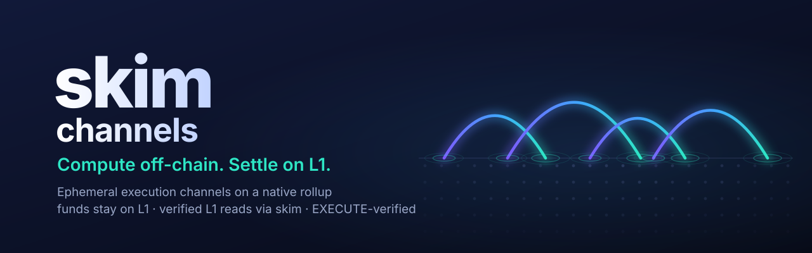
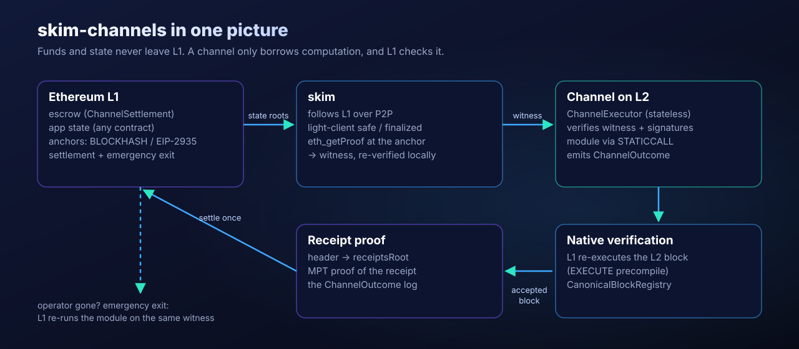

<p align="center">
  
</p>

<p align="center">
  <a href="#quick-start"></a>
  <a href="docs/guide/native-verification.md"></a>
  <a href="rust-toolchain.toml"></a>
  <a href="#license"></a>
</p>

<p align="center"><b>Funds and state stay on Ethereum. Channels only borrow computation, and L1 checks it.</b></p>

<p align="center">
  
</p>

**skim-channels** is an experimental architecture for running computation in ephemeral execution channels on a native rollup, with Ethereum L1 as the only persistent state.

A channel holds its participants' funds in an L1 escrow. It reads any L1 contract at an authenticated block through [skim](https://github.com/leekt/skim)'s verified proofs, computes on L2 without keeping application state of its own, and settles its outcome back on L1 exactly once. L1 checks the L2 execution by re-executing the block itself (the EIP-8079-style `EXECUTE` precompile). If the operator disappears, L1 re-runs the channel's computation directly.

```console
$ scripts/check.sh                  # fmt, clippy, Rust, fixtures, forge, viem, anvil e2e
$ ETHREX=../ethrex scripts/check.sh # + the native e2e on ethrex's EXECUTE prototype
...
ok  carol submitted L2 blocks 1..16 permissionlessly; EXECUTE-verified roots match ethrex's own
ok  settled under native-reexecution-devnet: 1.4 / 0.6
NATIVE E2E PASSED
```

---

## Why this is possible now

Three pieces arrived at once:

- **Verified L1 state without a full node.** [skim](https://github.com/leekt/skim) follows L1 over P2P, authenticates `safe` and `finalized` with a light client, and serves `eth_getProof` at exact blocks. A channel gets Merkle proofs of exactly the L1 state it reads.
- **Native rollups.** [EIP-8079](https://eips.ethereum.org/EIPS/eip-8079) lets L1 re-execute an L2 block (`EXECUTE`). There's no separate proof system to trust, and no Security Council needed for it. ethrex ships a runnable prototype, which is what this repo is tested against.
- **Ephemeral channels.** A channel's outcome is a pure function of (signed request, input, L1 state at an anchor). There's no long-lived L2 application state, so there's very little to secure and nothing to recover when the operator is gone.

## The model

| | Where it lives | Lifetime |
|---|---|---|
| Assets (escrow) | L1 `ChannelSettlement` | Until settle, exit or refund |
| Application state the channel reads | Any L1 contract, proven at an anchor | Permanent (it's L1) |
| Channel computation | L2 `ChannelExecutor` + an approved module, run via `STATICCALL` | One transaction |
| Outcome | An L2 receipt (`ChannelOutcome` log), proven into an L1-accepted block | Until settled |
| Settlement | L1 | Permanent |

**Lifecycle:** open and fund on L1 → preview against newer anchors as L1 changes (no reopen) → every participant signs one final request → it executes on L2 → L1 accepts the L2 block (re-execution) → the receipt is proven and the channel settles once. Without settlement by the deadline, anyone can refund. If the operator is gone, anyone can start the [emergency exit](docs/guide/stage-2.md).

## What we measured

| | Result |
|---|---|
| **Native verification, end to end** | On ethrex's EXECUTE prototype, with no mocks anywhere in the test: an unprivileged account submitted every L2 block, L1 re-executed each, the accepted roots matched ethrex's own, and the channel settled 1.4 / 0.6 exactly once ([log](docs/experiments/m3-native-ethrex.md)) |
| **Live L1 reads via skim** | Sepolia anchors promoted only by skim's light-client `finalized`/`safe` heads. Witnesses (WETH, 2 slots plus code) collected at those exact roots in **~1 s**, 13 KB each ([log](docs/experiments/m1-live-skim.md)) |
| **Fast confirmation** | Lighthouse v8.3.0 `fast_confirmation`: anchors confirmed at the chain head, **69–77 blocks ahead of finality** ([log](docs/experiments/m4-fcr.md)) |
| **Settlement cost** | L1 `settle` 320k gas (1-tx L2 block) → ~396k (127 or 255 txs); `settleFromBlock` 281k vs. 315k per channel (forge, two in one block); evidence 2.5–3.5 KB ([log](docs/experiments/m4-settlement-cost.md)) |
| **Native verification cost** | ~16M gas per L2 block, about the L2 gas limit: one L2 block per L1 transaction |
| **Correctness** | 50 Rust and 88 Solidity tests; every security check mutation-checked (removing it makes a named test fail) |

## Architecture

| Path | Role |
|---|---|
| `crates/channel-types` | Anchors, terms, policy, requests, execution profiles: EIP-712 commitments, strict decoding |
| `crates/channel-witness` | Exact-root L1 witness packages and their verifier; `AnchorBook` (confirmation, reorgs, prefetch); fork-tolerant header decoding |
| `crates/channel-receipts` | Receipt tries: roots, proofs, strict receipt decoding |
| `crates/channel-runner` | The runtime and the `skim-channels` CLI: hash-checked headers, skim and FCR confirmation sources, receipt evidence |
| `contracts/` (L1) | `ChannelSettlement`, `EmergencyExit`, `AnchorRegistry`, `AnchorSender`, `CanonicalBlockRegistry` + `RollupGovernance`, `NativeRollupRegistry`, message queues, `BatchSettler` |
| `contracts/` (L2) | `ChannelExecutor`, `L2AnchorInbox`, `L1StateReader`, modules (`SplitModule`) |
| `contracts/src/verifiers` | `WitnessVerifier`, `ReceiptVerifier`, `ExecuteVerifier` (EXECUTE), `ProofDependencyVerifier` (EIP-8288 adapter, not deployable yet) |
| `ts/` | viem cross-checks of every commitment; `e2e.ts` (two anvil chains) and `e2e-native.ts` (ethrex) |

## Quick start

```console
$ cargo test --workspace                       # Rust (anvil tests run if anvil is installed)
$ cd contracts && forge test                   # Solidity
$ cd ts && npm ci && npm run check-encodings   # Rust ↔ Solidity ↔ viem commitments
$ cargo build -p channel-runner && cd ts && npm run e2e   # Read-and-Split on two anvil chains
```

Requires Rust 1.97, Foundry and Node ≥ 23. The native e2e needs an ethrex checkout built with native rollups. See [Getting started](docs/guide/getting-started.md).

## Documentation

| What you need | Guide |
|---|---|
| The project in three lines, and the questions people ask | [FAQ](docs/guide/faq.md) |
| Decide whether channels fit your app | [Use cases](docs/guide/use-cases.md) |
| Compare with optimistic and zk rollups and state channels | [Compared](docs/guide/compared.md) |
| Build, test and run the end-to-end demos | [Getting started](docs/guide/getting-started.md) |
| Understand anchors, witnesses, execution and settlement | [How it works](docs/guide/how-it-works.md) |
| See what skim provides and what it doesn't | [Using skim](docs/guide/using-skim.md) |
| Native verification, registries, data availability and blobs | [Native verification](docs/guide/native-verification.md) |
| What to deploy once, contract sizes and costs | [Deployment](docs/guide/deployment.md) |
| The `skim-channels` CLI | [CLI reference](docs/guide/cli.md) |
| What's verified and what's trusted | [Trust and correctness](docs/guide/trust-and-correctness.md) |
| Exits without the operator, governance, forced inclusion | [Stage 2](docs/guide/stage-2.md) |
| Known failure modes and their causes | [Troubleshooting](docs/guide/troubleshooting.md) |

Full index: [docs/README.md](docs/README.md).

## Correctness rules this project lives by

- **Unknown state is never zero.** A read the witness doesn't cover is an error. Zero needs a proof of absence.
- **One execution, one authenticated L1 root.** Proofs from two roots never mix, and a cached value never passes for a proof at a newer root.
- **Every anchor is re-authenticated on L1.** Settlement accepts only anchors whose hash matches L1's own block hash.
- **Mocks are labeled and can't pass as native.** A settlement deployed for a native profile rejects a mock registry.
- **Exactly one terminal transition** per channel: settle, exit or refund.

## Trust model

See [Trust and correctness](docs/guide/trust-and-correctness.md). In short:
- Execution is verified by L1 re-execution.
- Block data is on L1.
- L1 reads are Merkle-proven against authenticated roots.
- Funds never leave L1.

What remains trusted:
- skim's light client, for `safe`/`finalized`;
- a full beacon node, for FCR;
- ethrex's EXECUTE prototype, which is not production software.

## License

Licensed under either of [MIT](LICENSE-MIT) or [Apache-2.0](LICENSE-APACHE), at your option.
