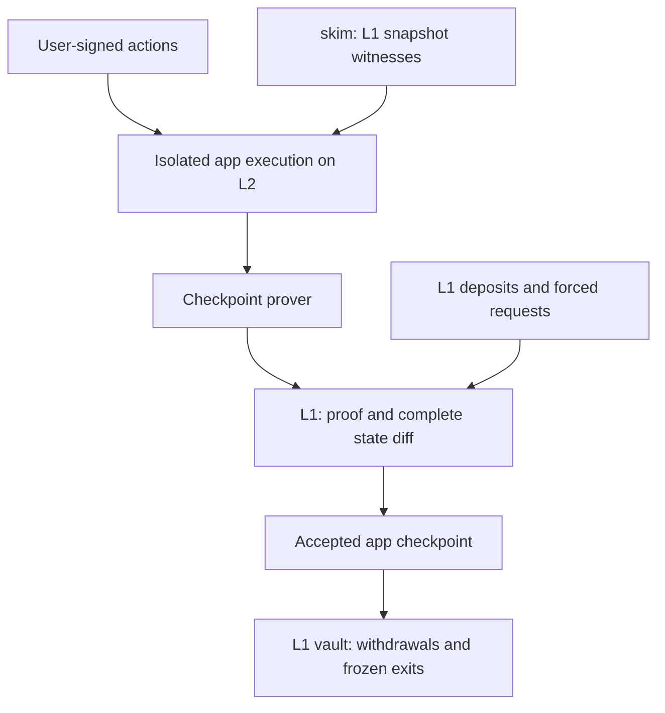

# App channels: prove checkpoints, publish recoverable state

**Status:** design adopted 2026-10-22 as the direction for app channels. It replaces the earlier app-channel proposal, not the existing computation-channel implementation.
- **Built so far:** the vault and checkpoint accounting, behind a labeled mock verifier, together with experiments 1, 2 and 4 from §9. See [Implementation status](#implementation-status).
- **Pending:** a real proof system (decision 1).

**Origin:** an external design review (Codex) of `main` at `47a0687`, based on the repo's docs, experiments and contracts. Gas figures quoted from the experiment logs are measured; the others are estimates, marked as such.

## 1. Decision

Use the L2 as an execution environment. The object L1 accepts is an **application checkpoint**, not an L2 block:

- Assets remain in a multi-asset L1 vault.
- The app's contracts execute many authorized interactions off-chain. skim supplies authenticated, read-only L1 snapshots.
- A validity proof establishes the app's transition from the previous accepted checkpoint.
- L1 receives that proof plus a **complete net state diff**, enough to reconstruct the resulting app state and withdrawal rights.
- Users withdraw against accepted checkpoints. If the operator disappears, users freeze the last accepted checkpoint and exit without generating another execution proof.

This is an **app-specific validity rollup with channel lifecycles**. The deployment may expose ordinary L2 RPCs and blocks, but those host blocks are not the settlement authority. When a channel closes, its logical state ends; its accepted commitments and recovery data remain.

**This reopens a previous decision.** The [Stage 2 guide](stage-2.md) rejected a non-native zkVM verifier. The recommended design uses an existing Ethereum-verifiable proof system. EIP-8288 reserves its STARK dependency scheme, which blocks the *native* route, but not ordinary Solidity proof verification: existing zkVMs have Ethereum verifiers today.[1][2]

If **native-only verification remains mandatory**, the current EXECUTE backend gives no general computation savings. The options are then a narrower consent-based channel model, a different verification mechanism, or waiting for native proof verification. The existing path should not be described as cheap merely because it executes on an L2 first.

## 2. What the design was missing

The original computation channel has a simple enforceable outcome: every fixed participant signs a request, and one pure module evaluates that request against an L1 witness. An app channel adds open membership, persistent session state, shared balances and independent withdrawals. It therefore needs an authoritative ledger, including a rule that turns every accepted state into exit rights.

The earlier proposal got that authority from EXECUTE. Removing EXECUTE without replacing its role leaves three gaps:

1. **Validity:** which balance changes did users authorize, and did the app's rules permit them?
2. **Availability:** can someone other than the operator reconstruct a balance and produce its proof?
3. **Finality and accounting:** which checkpoint governs an exit, and how do already-paid withdrawals and later deposits interact with it?

None of the existing pieces fills these gaps on its own:
- A Merkle proof shows inclusion only.
- An operator signature identifies the operator.
- A higher nonce orders checkpoints only once their validity is established.
- `totalPaid <= totalDeposited` prevents a vault overdraft, but it doesn't stop a forged first claimant from taking other users' backing.

The EXECUTE cost problem is real, not just empty-block inefficiency. ethrex charges the block gas limit plus input-byte cost, because the claimed gas used is not a safe bound on verification work. The [native experiment](../experiments/m3-native-ethrex.md) measured **16,040,219 gas per accepted L2 block**, plus settlement. Reducing idle blocks or their limits saves wasted capacity; it doesn't compress execution.

"We only need the outcome" should mean **prove the intervening computation off-chain and publish the resulting recoverable state**. It can't mean accepting an arbitrary outcome without evidence that it follows from the prior state.

For the existing small computation channel, evaluating the module directly on L1 already avoids the whole-block charge. A cooperative path could settle an exact payout vector signed by everyone. Those are useful small-channel optimizations, but neither supplies a general open-membership ledger.

## 3. Execution and checkpoint model

### Isolate the app's state

An app deploys its own contracts. Its channel fixes:
- the program and fork rules;
- contract addresses and code, and the initial configuration;
- allowed tokens and authorization rules;
- the emergency exit rule.

The app may write **its own session state**. L1 state is a separate, read-only namespace, exposed through an explicit witness-backed reader. The only L1 effects this protocol authorizes are vault accounting and payment of that channel's escrow. Reading an L1 pool doesn't let the app trade with the pool or spend its assets.

For the first version, prohibit dependencies on unrelated host-L2 state and cross-channel calls. Every economically relevant call, storage access and environment value must be inside the proven execution domain. A proxy's runtime code hash alone doesn't fix its implementation or administration, so use immutable dependencies and configuration, or include their permitted changes in the proof rules.

Constrain the environment too:
- VM time and height derive from the authenticated L1 anchor and the checkpoint rules. Host-chosen timestamps, block hashes or randomness are not authoritative.
- Unsupported randomness-dependent behavior is rejected.
- Actions bind their snapshot, or an explicit snapshot-selection rule.
- Action expiry uses the defined VM time; forced deadlines use L1 time.

This restriction is what makes proving just the app meaningful. An app that depends on a host AMM, another channel or arbitrary mutable contracts drags those dependencies into the verification problem.

### Checkpoint commitments

| Commitment | Purpose |
|---|---|
| L1 chain, vault, channel id, epoch and configuration hash | Domain separation; immutable rules |
| Previous checkpoint hash and next checkpoint nonce | Exactly one accepted successor chain |
| New app-state root | All persistent session state |
| Exit-entitlement root | Operator-independent termination at this checkpoint |
| Consumed deposit and forced-request cursors, and queue commitments | No invented, skipped or double-credited inputs |
| Cumulative withdrawal-credit commitment | Withdrawals stay valid after later checkpoints |
| Authenticated L1 anchor reference and policy bounds | Correct, sufficiently fresh snapshot reads |
| Complete published-data commitment | Binds the proof to the actual recovery data |

Signed interactions use **per-account action nonces**; a global checkpoint nonce is not a replay nonce for every user.

L1 accepts a checkpoint only if:
- its predecessor equals the current accepted checkpoint;
- its nonce is the expected successor;
- its proof verifies;
- its public inputs match the L1 channel configuration, the queues and the published data.

Competing valid histories may exist off-chain, but only one can extend the accepted predecessor. A larger nonce can't replace an already accepted history.

### What the proof establishes

1. Starting from the accepted previous state, the registered contracts and execution rules process the batch correctly.
2. Every user action has the required signature or prior permission, with the correct domain and action nonce. Contract-driven changes satisfy the immutable app rules.
3. Deposits correspond to actual vault records. Forced requests are genuinely applied, not merely included in a message hash.
4. Every L1 read verifies against the authenticated anchor selected for that interaction. Missing state fails closed, and absence requires a proof.
5. Balances, withdrawal credits and exit entitlements conserve each token's backing. App fees are explicit ledger allocations.
6. Executing the batch yields the claimed new state.
7. Applying the exact published net diff to the previous recoverable state also yields that state, and reconstructs the claimed exit information. Hashing a diff into the public inputs without checking this relationship isn't enough.

A batch may contain thousands of interactions. The prover executes their computation; L1 verifies a succinct statement about it. No receipt proof against an unverified L2 block is involved.

### Open membership without unanimous signatures

A new user's L1 deposit creates an authenticated deposit record, and anyone can carry it into a batch. Users sign their own actions, not the global state root, so other users needn't sign or be online.

Example: Alice authorizes an app action that affects her balance. The proof checks her authorization and the app's rules for the resulting changes to Bob or to a pool. It can't debit Bob merely because the operator submitted a newer checkpoint. Bob's consent, or an existing rule he opted into, must authorize that debit.

Proof validity doesn't guarantee fair ordering, good prices or benign app rules. Signed constraints such as minimum output, expiry and spending limits must be enforced by the proven program.

## 4. DA and L1 reads

### Publish net state, not every intermediate transaction

Each accepted checkpoint publishes enough data to reconstruct:
- all changed app storage, deletions included;
- balances, positions, liabilities, permissions and action nonces;
- exit entitlements and cumulative withdrawal credits;
- queue-processing state;
- any code or configuration needed to continue execution.

The genesis state and registered code must also be available. A balance-only diff isn't enough for an app with outstanding positions or other persistent state.

**Use calldata DA first.** The proof binds to the exact posted bytes and proves they're complete. Updating the same balance 1,000 times can need just one final balance update in DA, but creating 1,000 persistent orders generally can't be compressed that way. Data cost follows the recoverable changes; it's not constant.

Full state-diff DA with validity proofs is an established construction. Publishing every historical transaction isn't required to reconstruct the final state.[3]

**Limits on size and work:**
- Bound checkpoint data size and proving work.
- If data spans several L1 transactions, every committed chunk must be published before the checkpoint is accepted.
- Channel-wide exit allocation is computed and proven off-chain. L1 never loops over all members to freeze or pay them.

### Who holds data, and who must watch

| Party | Required role |
|---|---|
| Operator / prover | Keeps batch inputs, witnesses and execution state until proof and DA are accepted; provides normal service |
| Independent node | Reconstructs accepted state from L1 genesis, configuration and diffs; generates claims; can resume execution |
| User | Keeps account credentials; can recover accepted rights from public data without having watched every update |
| Keeper / watchtower | Optional automation for forced requests, freeze and claims. Not an honest-challenger assumption for validity |

If the operator withholds an input or refuses to prove a batch, that batch can't be accepted, and users exit from the preceding accepted checkpoint. **Unproven activity is provisional**, even if the L2 returned a receipt.

### Authenticate anchors once per epoch

v1 uses one L1 snapshot anchor per proving epoch.
- skim collects exact-block witnesses and authenticates its safe/finalized view locally.
- L1 independently authenticates the header through `AnchorRegistry`.
- A shared anchor is recorded once, not once per user interaction.

`AnchorRegistry` keeps recorded roots permanently. An unrecorded header, though, must be authenticated before the BLOCKHASH / EIP-2935 window expires: 256 blocks and 8,191 blocks respectively, the latter about 27 hours, not 30 days.[4] Record anchors early enough to survive a proving outage. Keep witnesses while any batch still needs proving.

Freshness must refer to an authenticated L1 reference height or time, not `L2AnchorInbox.latestNumber`, which can stall. Begin with finalized anchors, and expose the latency that results.

The current `postFromL1` inbox feed gets its authority from EXECUTE checking ethrex's message root. Without EXECUTE, the inbox is a cache and interface, and anchor and queue authority must come from checkpoint public inputs checked on L1.

## 5. Withdrawals and operator-independent exit

### Define redeemable rights before supporting an app

"Withdraw any time" means a user can start an exit at any time and eventually collect their **protocol-defined entitlement** without the operator's permission. It doesn't mean immediate L1 payment, return of the original principal, or cancelling a losing position at its purchase price.

Every accepted checkpoint already contains a proven, publicly reconstructible **exit-entitlement root**. The app's exit rule determines how the whole channel would terminate at that checkpoint, so claimants never need a new global closeout proof after the operator disappears.

For v1, support apps whose terminal allocation can be computed at every checkpoint:
- pending games need a cancellation rule;
- LP positions need a fixed reserve or share allocation;
- debt or margin positions need a defined closeout.

An app without a total, solvent termination rule is unsupported.

### Join and normal withdrawal

At channel creation the vault installs a canonical empty checkpoint: consumed cursor zero, withdrawal credits zero, exit allocations zero. If the operator disappears before the first proof, every deposit stays refundable from L1 records after a freeze, with no execution proof.

1. **Deposit:** the vault receives ETH or an allow-listed ERC-20 and records the amount actually received, the user and the queue index. Unsupported rebasing or fee-on-transfer semantics are rejected. The consumed queue prefix determines which deposits were credited.
2. **Interact:** users submit signed actions; the app executes them and publishes proofs periodically.
3. **Withdraw:** an authorized withdrawal debits spendable state and increases an irrevocable **cumulative withdrawal credit** for the user's L1 recipient and token.
4. **Claim:** once a checkpoint proves that credit, anyone can claim on the user's behalf. The vault pays only the increase over what it already paid. Later checkpoints can't revoke or spend those credits.

An authorized normal close publishes a proven terminal checkpoint and uses the same exit allocations. Expiry enters the close or freeze procedure; it doesn't refund original deposits after users have traded. Closing never deletes outstanding claim rights.

### Forced request, freeze and claim

- **Deadline:** each forced request is timestamped when it's recorded on L1, and the **one-day** service deadline starts then.
- **Processed or not:** the accepted checkpoint's cursor proves whether a request was processed.
- **Fence:** once an unprocessed request is overdue, **no further live checkpoint is accepted**. A late proof can't front-run `freeze` to restart the clock.
- **Freeze:** anyone can trigger it, using the L1 timestamp and the consumed cursor. No new L2 block, non-processing proof, operator signature or execution proof is needed.
- **Snapshot:** a freeze captures the accepted checkpoint, exit root, cumulative withdrawal credits and consumed deposit prefix. New deposits and updates stop, and the snapshot never rolls back or advances.
- **Claims:** after the payout delay, each user claims their frozen entitlement. Deposits outside the consumed prefix are refunded separately to their recorded owners.

One unserved, valid exit request is enough to terminate the whole channel. App service must be provisioned for the one-day deadline.

### Prevent inconsistent exits

For each token, let:
- `B` = frozen exit allocations, excluding withdrawal credits already created;
- `E` = cumulative withdrawal credits ever created;
- `P` = credits already paid on L1;
- `D` = deposits consumed by the accepted checkpoint.

The proof enforces **sum(B) + sum(E) = D**. A user's unpaid rights are their frozen allocation, claimed once, plus E − P. Uncredited deposits use separate per-deposit refund nullifiers. Earlier credit claims and later frozen claims therefore draw from disjoint entitlements.

- Never freeze at an older balance root after paying withdrawals from a newer one.
- Never refund a deposit that's already in the frozen consumed prefix.
- No post-freeze proof may credit a refunded deposit.

### The challenge window

A sound validity proof plus DA doesn't need a stale-state dispute. The owner's clamped 1-hour-to-30-day window becomes a **frozen-root payout delay**: no extensions, and no replacement of the frozen root. Normal claims against irrevocable credits need no delay. The worst-case forced path is **one day + the window + L1 inclusion and finality time**.

This exit protects against an operator or prover becoming unavailable, assuming the proof system is sound. It does not recover funds that a broken verifier already misallocated.

## 6. L1 cost model

The saving comes from avoiding L1 re-execution and batching recoverable changes, not from a constant total cost per channel.

For U joins, V claims, K checkpoints and A registered anchors:

**Lifetime L1 gas ≈ open + U × deposit + V × claim + Σ checkpoint costs + A × anchor registration + forced-exit costs**

Ordinary interactions have **no standalone L1 transaction**. Their L1 cost is their share of checkpoint verification and DA.

| Operation | Frequency | Gas (measured or estimate) |
|---|---|---:|
| Open channel | per channel | 150k–350k estimate (the existing fixed-participant open measured 300,830) |
| ETH deposit | per user or top-up | 60k–120k estimate |
| ERC-20 deposit | per user or top-up | 90k–180k estimate |
| Checkpoint verification overhead | per batch | 350k–650k estimate, plus calldata |
| Withdrawal claim | per claim | 70k–180k estimate |
| Forced request / freeze | when needed | 60k–150k each, estimate |
| Frozen claim | per user and token | 90k–200k estimate |
| Anchor registration | per distinct anchor | 134,172 measured (111,953 before `anchorIdAt` was added for outcome-independent voiding) |

As an external reference, SP1 documents roughly **270k gas** for Groth16 verification and **300k** for PLONK.[2]

**Calldata (EIP-7623):** G = 21,000 + max(G_execution + 4T, 10T), where T = zero bytes + 4 × nonzero bytes.[6]

**Illustration, not a benchmark:**
- Setup: 100 users, 10,000 interactions, ten checkpoints of ~683k each (400k execution plus 16 KiB of diff), 80k deposits, 100k claims, a 300k open.
- Result: **≈ 26.3M gas over the channel's life, ≈ 2.6k per interaction**.
- Comparison: about 1B gas for the same actions at 100k each on L1.

Exit-entitlement fan-out can make diffs larger: one shared price change may update every user's exit leaf. Measure before budgeting. Don't submit empty checkpoints.

## 7. Mapping to the existing repository

| Existing component | Treatment |
|---|---|
| `ChannelSettlement` | Reuse its escrow-isolation, pull-payment and conservation patterns. App channels get a separate multi-asset, open-membership vault (`AppChannelVault`) |
| `MerklePatricia`, `EthTypes`, `RLP` | Reuse for L1 headers and witnesses. App state uses a purpose-built bounded binary tree (`AppLeaves`) |
| `WitnessVerifier`, `WitnessLib`, `L1StateReader` | Keep their exact-root, absence and fail-closed checks; carry them into the proven program |
| `AnchorRegistry` | Reuse; anchors are recorded once per epoch |
| `L2AnchorInbox` | Becomes a cache and API; authority moves to checkpoint public inputs |
| `EmergencyExit` | Reuse the permissionless triggers and fixed deadlines; replace its protocol for app channels |
| `ChannelExecutor` | Keep for computation channels; app channels need an isolated stateful proving adapter |
| `CanonicalBlockRegistry`, `ExecuteVerifier`, `NativeRollupRegistry` | Keep for experiments and differential checks; not used by the app settlement path |
| `ReceiptVerifier`, `channel-receipts`, `BatchSettler` | Keep for computation channels; app checkpoints need no receipt proofs |
| Forced-inclusion queues | Reuse the ordered-commitment idea, with channel-specific L1 timestamps |
| `RollupGovernance` | Keep the 30-day policy intent; existing channels' rules stay pinned |
| skim, `channel-witness`, `channel-runner` | Keep; add witness retention, checkpoint reconstruction and proof generation |
| `channel-types` and fixtures | Add versioned checkpoint, data and leaf formats, with the same cross-language checks |

## 8. Disputes, alternatives and classification

**Recommended validity profile:** no optimistic dispute is needed. Invalid proofs, or conflicting predecessors or nonces, are rejected at submission.

The assumptions are:
- Ethereum consensus, and access to its published data;
- correctness of the prover and verifier;
- the pinned app and exit rules;
- token behavior;
- someone eventually sending L1 transactions.

Normal service needs a live prover; exiting from the last accepted checkpoint doesn't.

If avoiding a validity prover matters more, there are two legitimate alternatives, but each changes the product:

| Alternative | Security mechanism | Consequence |
|---|---|---|
| Optimistic app rollup | Full replayable batch-input DA, bonded assertions, a permissionless fraud game | At least one honest online challenger; slower finality; substantial dispute machinery |
| Segregated user–app channels | Signed states, reserved collateral, watchtowers | No interaction data on L1, but limited shared-state composability, and not a rollup |

Never fall back automatically from validity proofs to weaker settlement within the same vault.

**Stage 2 and governance.** Complete L1 state-diff DA, plus proofs, plus permissionless recovery is compatible with a rollup architecture. Neither architecture grants an official Stage 2 rating.[8]

30-day governance and an up-to-30-day exit window need reconciling, since a user may need more than 31 days to complete the forced path. Recommended: upgrades take effect after 30 days **for new channels only**, and existing channels keep immutable rules.

## 9. Decisions and highest-risk experiments

### Decisions

1. **Verification:** a non-native zkVM verifier (SP1, RISC Zero). *Deferred by the owner (2026-10-22); see [future considerations](future-considerations.md). The mock stays until then.*
2. **Exit semantics:** a proven terminal allocation at every checkpoint. Start with one app whose allocation is simple.
3. **Finality budget:** checkpoint cadence, and acceptance that unproven interactions can disappear.
4. **Window semantics:** keep the window as a frozen-root payout delay, or retire it for proven roots. Keep the one-day forced service either way.
5. **Upgrade scope:** existing channels stay immutable.
6. **App logic form:** apps stay **Solidity contracts** (owner). How their results are enforced on L1 is decided per app first; a zkEVM proof is one possible answer, not a given.

### Highest-risk experiments

| # | Experiment | Required result |
|---|---|---|
| 1 | Kill the operator, prover and RPC, both before the first proof and after a checkpoint; recover using only L1 records and published data | All uncredited deposits refunded in the first case; in the second, state reconstructed and every accepted exit right claimed, with no new proof or old skim RPC |
| 2 | Joins, transfers, withdrawals, pending deposits and freeze, in adversarial order | Per-token backing stays exact; no double claim via an old root, cumulative credit, frozen balance or deposit refund |
| 3 | A real app proof, complete diff and exit root; mutate each public input; omit an update | Every incorrect transition or unrecoverable state rejected |
| 4 | Cross the one-day boundary while submitting a late checkpoint and racing freeze and claims | The deadline fence fixes one snapshot; no operator action postpones the exit |
| 5 | Terminate an app with unresolved positions | Non-overlapping, executable allocations for every token |
| 6 | Anchors older than 8,191 blocks; a 30-day exit; reorgs; a stalled inbox | Recorded anchors remain sound; exits need no historical witness |
| 7 | 100 / 1,000 / 10,000 actions, with repeated vs. unique state and a shared update | A measured break-even point against a batched L1 app |
| 8 | An upgrade scheduled during the longest forced exit | Existing claim rules stay usable until the exit completes |

**Build gate:** demonstrate recoverable exit and exact asset accounting first, then measure a real proof's cost.

## Correction (owner review, 2026-10-22)

The validity-rollup shape above was a **design choice**, not something the requirements forced:
- **"Cheaper than L1"** means L1 must not repeat all computation on the **normal path**. L1 may still execute what a **dispute** needs. Optimistic settlement remains a valid option.
- **"Many users"** doesn't mean "everyone signs one shared state." If an app's interactions and their collateral can be separated (ledger or virtual channels, as in Nitro), channel-style settlement among the involved parties may suffice. The first question is whether the app is one shared ledger.
- **The vault is validity-shaped:** a verifier's `true` finalizes roots immediately. An optimistic profile needs a **different settlement protocol**, with pending roots, challenges, finalization and replayable inputs in DA, not just a different verifier. The accounting code is reusable; the protocol isn't the same.

**Next:** pick one app and specify how its results are enforced on L1:
- what users sign;
- who detects a wrong result, and with what evidence;
- what L1 checks, whether conditions on the result or part of the execution;
- which state withdrawals use if data is withheld or the operator disappears.

Choose the proof or dispute mechanism after that. Done for four apps in [app enforcement rules](app-enforcement.md).

## Implementation status

**Update (2026-10-22): two app paths are now built without any mock verifier.**
- **[Prediction rounds](../experiments/prediction-round-cost.md):** optimistic, with every root computed on L1.
- **[Clearing](stateful-runtime.md):** stateful Solidity on a local executor, with each fill re-checked on L1 and only signatures optimistic.

The validity-shaped `AppChannelVault` below still has only the labeled mock verifier.

The checkpoint accounting is built and tested behind `MockAppCheckpointVerifier`, a **labeled mock** that binds proofs to the public inputs but doesn't check execution. What this demonstrates: **given correct checkpoints**, accounting, the deadline fence and recovery work. It does not show that a checkpoint's balances are legitimate.
- `AppChannelVault`: multi-asset deposits, forced requests with L1 timestamps, checkpoint acceptance with the deadline fence, freeze, credit / exit / refund claims, per-token solvency.
- `AppLeaves`: the bounded binary tree for exit and credit leaves.
- The `channel-app` crate: the reference ledger (the mock prover), the net-diff codec and reconstruction.
- `skim-channels app-checkpoint` / `app-recover`: recovery reads only `CheckpointAccepted` events and their calldata.

Experiments **1, 2 and 4** pass; see [experiments](../experiments/app-channels-accounting.md). Experiments 3 and 5–8 wait on decisions 1 and 6.

## Sources

1. [EIP-8288](https://eips.ethereum.org/EIPS/eip-8288); [EIP-8357](https://eips.ethereum.org/EIPS/eip-8357).
2. [SP1 proof types](https://docs.succinct.xyz/docs/sp1/generating-proofs/proof-types); [RISC Zero on Ethereum](https://dev.risczero.com/api/blockchain-integration/risc-zero-on-eth).
3. [ZKsync standard pubdata format](https://matter-labs.github.io/zksync-era/core/latest/specs/contracts/settlement_contracts/data_availability/standard_pubdata_format.html).
4. [EIP-2935](https://eips.ethereum.org/EIPS/eip-2935); [`AnchorRegistry`](../../contracts/src/AnchorRegistry.sol).
5. [M2 anvil](../experiments/m2-anvil-e2e.md); [M3 native](../experiments/m3-native-ethrex.md); [M4 settlement](../experiments/m4-settlement-cost.md).
6. [EIP-7623](https://eips.ethereum.org/EIPS/eip-7623).
7. [`ChannelSettlement`](../../contracts/src/ChannelSettlement.sol); [`EmergencyExit`](../../contracts/src/EmergencyExit.sol).
8. [L2BEAT stages](https://l2beat.com/stages).
