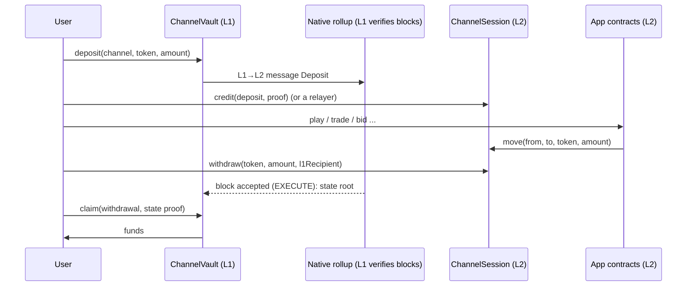
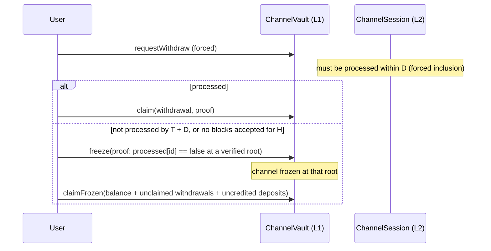

# App channels (design, proposed)

**Status:** proposed 2026-10-22, for owner review. Not implemented. This doc describes the target; the existing [computation channels](how-it-works.md) stay as they are.

## The idea

An app opens a **channel**: a session on the native rollup that serves the app's users.

1. Users join at any time by **locking assets on L1** (ETH or allow-listed ERC-20).
2. Inside the channel they **use the app** on L2: many transactions, cheap and fast, against balances that mirror their L1 deposit.
3. They can **leave at any time**: withdraw on L2, then claim on L1.
4. When the app closes the channel, everyone takes their final balance.

Funds never leave L1. They sit in a vault there the whole time, and L1 pays out only against L2 state that L1 itself verified by re-execution.

**Owner decisions (2026-10-22):**
- withdraw any time, not only at close;
- app logic is the **app's own contracts**, registered by code hash;
- ETH plus allow-listed ERC-20;
- apps get **read-only access to L1 state**: they can read it on L2 but never modify it.

## L1 state: readable, never writable

Apps in a channel can **read any L1 state** but **can't modify it**. This holds by construction, not by policy.

**How an app reads L1.** A transaction carries a witness: Merkle proofs from skim's `eth_getProof` at an anchor that `L2AnchorInbox` holds. Anchors reach L2 trustlessly as proven L1 messages, BLOCKHASH-checked on L1. The app verifies the witness through `WitnessVerifier`, or `L1StateReader.readStorage` for a single slot, and gets the values at that L1 block. One transaction reads one anchor, so its view of L1 is consistent. Freshness is the channel's `maxAnchorLag`.

**Why it can't write:**
- A witness is only proof data. There is no path from L2 to an L1 contract's storage, and no L2 call reaches L1.
- The only L2→L1 effect is `ChannelVault` paying out **that channel's own escrowed deposits**, and only against L2 state that L1 verified.
- Reading a pool, an oracle or a balance on L1 grants no right to move it. For example, an app can price a trade off a Uniswap pool's reserves, but it can't touch the pool's tokens.

**Example:** a prediction game settles each round on the ETH/USDC price read from an L1 pool at an agreed anchor. Players' stakes move only between channel balances on L2. On L1, only the vault pays out, and only from deposits.

| Direction | Allowed | Mechanism |
|---|---|---|
| L1 state → L2 app | Read, any contract | Witness at an inbox anchor (skim proofs) |
| L1 vault → L2 balances | Deposits | Proven L1 message from the vault |
| L2 → L1 vault | Payouts of the channel's own escrow | Withdrawal or balance proven at an L1-verified L2 state root |
| L2 → any other L1 contract | **Never** | No mechanism exists |

## How it differs from computation channels

| | Computation channel (built) | App channel (this design) |
|---|---|---|
| Participants | Fixed at `open`, all sign the close | Open membership; join and leave any time |
| Interactions | One final request | Many L2 transactions |
| L2 state | None (pure function) | **Session state** (balances, app state), living only for the channel |
| Settlement | One receipt, one payout split | Each user claims their own balance or withdrawal, by L2 **state proof** |
| Exit without the operator | L1 re-runs the module | **Freeze**: the channel locks at a verified L2 state, and everyone claims from it |

The core principle shifts from "no per-channel L2 state" to **"per-channel state that lives only for the session"**. Persistent truth stays on L1: the vault and its payouts.

## Components

### L1: `ChannelVault` (one deployment, many channels)

| Function | Who | What |
|---|---|---|
| `openChannel(app, session, appCodeHashes, tokens, closeDeadline)` | App | Registers the channel: L2 session address, approved app code hashes, allowed tokens |
| `deposit(channelId, token, amount, l2Account)` | User | Locks funds and sends an L1→L2 message `Deposit(id, user, token, amount)` |
| `requestWithdraw(channelId, token, amount)` | User | **Forced path:** sends an L1→L2 message `ForcedWithdraw(id, user, token, amount)`, with time T recorded |
| `claim(channelId, l2Block, withdrawal, proofs)` | Anyone, for a user | Pays a withdrawal recorded in the session, proven at an **accepted** L2 state root |
| `freeze(channelId, l2Block, proofs)` | Anyone | Freezes the channel if a deposit or forced withdrawal wasn't processed by its deadline (proven *not processed* at a verified root after T + D), or if no L2 block was accepted for H |
| `claimFrozen(channelId, user, token, proofs)` | Anyone, for a user | After a freeze: pays the user's balance at the frozen root, plus their unclaimed withdrawals and uncredited deposits |
| `claimClosed(channelId, user, token, proofs)` | Anyone, for a user | After a normal close: pays the final balance, proven at a root where the session is closed |

**Solvency:** per channel and token, total paid out ≤ total deposited, enforced on L1 whatever the L2 says.

### L2: `ChannelSession` (one per channel)

Storage has a fixed, documented layout, so L1 can verify it by proof:
- `balances[user][token]`
- `withdrawals[id]` (hash of user, token, amount, L1 recipient)
- `processed[messageId]`
- `closed`

| Function | Who | What |
|---|---|---|
| `credit(deposit, msgProof)` | Anyone (relayer or user) | Proves the vault's `Deposit` L1 message (same mechanism as the trustless anchor feed: the L1-messages root via EIP-4788), then credits the balance once |
| `withdraw(token, amount, l1Recipient)` | User | Debits the balance and records a withdrawal, claimable on L1 once the block is accepted |
| `forceWithdraw(msg, msgProof)` | Anyone | Proves the vault's `ForcedWithdraw` message, then debits and records it |
| `move(from, to, token, amount)` | **Registered app contracts only** | The app's logic moves balances between channel members |
| `close()` | App, or anyone after `closeDeadline` | Stops `move`; balances become final |

**App logic:** the app deploys its own contracts on L2. Their code hashes are fixed at `openChannel`, and the session accepts `move` only from contracts with those code hashes. Users trust the app's **code**: immutable, and its execution verified by L1. They don't trust the app's **operator**. Apps can also read L1 state through skim witnesses (`L1StateReader`, `WitnessVerifier`), as computation channels do.

## Flows

**If the operator censors or disappears:**

Freezing is the escape hatch. One censored request locks the channel at a verified L2 state and every user exits from it, so censoring anyone costs the app the whole channel. No operator is needed for any of this: proofs are against L1-verified roots, and anyone can submit blocks and relay messages.

## Why each piece is trust-minimized

- **Deposits can't be faked.** L2 credits only messages proven to come from the vault, inside an EXECUTE-verified block.
- **Withdrawals can't be faked.** L1 pays only against L2 state at roots L1 re-executed itself.
- **No double spend:**
  - each withdrawal id is claimable once;
  - after a freeze, only frozen-root balances count;
  - balances already exclude processed withdrawals.
- **No censorship:** a forced request either gets processed or freezes the channel.
- **No insolvency:** L1 caps payouts per channel and token at deposits.

## What it reuses

| Need | Existing piece |
|---|---|
| L2 execution verified by L1 | `CanonicalBlockRegistry` + `ExecuteVerifier` |
| L1→L2 messages with provenance | the `AnchorSender` / `postFromL1` pattern (proof against the EIP-4788 L1-messages root) |
| L2 state proofs on L1 | `MerklePatricia`, `EthTypes` (account and storage proofs) |
| Forced inclusion and governance | `NativeRollupMessageQueue`, `RollupGovernance` |
| L1 reads inside apps | skim witnesses, `WitnessVerifier`, `L2AnchorInbox` |

## Open questions for review

1. **Shared or dedicated L2.** Proposed: one native rollup shared by many apps, with one session per channel, which is cheaper. Alternative: a dedicated rollup per app, which is heavier because every rollup pays ~16M gas per L2 block for EXECUTE.
2. **L2 gas for users.** Who pays? Options: users bridge a little ETH through ethrex's bridge; the app sponsors through a relayer or paymaster; or the session deducts fees from channel balances.
3. **Exit delay `D`** for forced requests, and **`H`** for "no block accepted". Proposed: 1 day each, matching `FORCE_DELAY`.
4. **App code upgrades** during a channel. Proposed: none. Code hashes are fixed per channel; a new version means a new channel.
5. **How much power `move` gives the app.** Proposed: any movement among channel members, since users opt into the app's code. Alternative: per-user allowances.
6. **Previews and confirmations.** Deposits credit after the L1 message is relayed. Should the app require `finalized` (or FCR) anchors before crediting?

## Effort estimate

- **Contracts:**
  - L1: `ChannelVault` (deposits, claims, freeze).
  - L2: `ChannelSession`, the message-proof library (shared with the inbox), and an example app (e.g. a simple game or market).
- **Tests:** forge unit tests for every path (credit, move, withdraw, claim, forced, freeze, close), mutation-checked.
- **e2e:** extend `ts/e2e-native.ts` on ethrex:
  - users join, transact and withdraw;
  - one forced withdrawal;
  - one freeze after a simulated censorship;
  - claims from the frozen root.
- **Docs:** this guide becomes the reference, plus FAQ entries.
